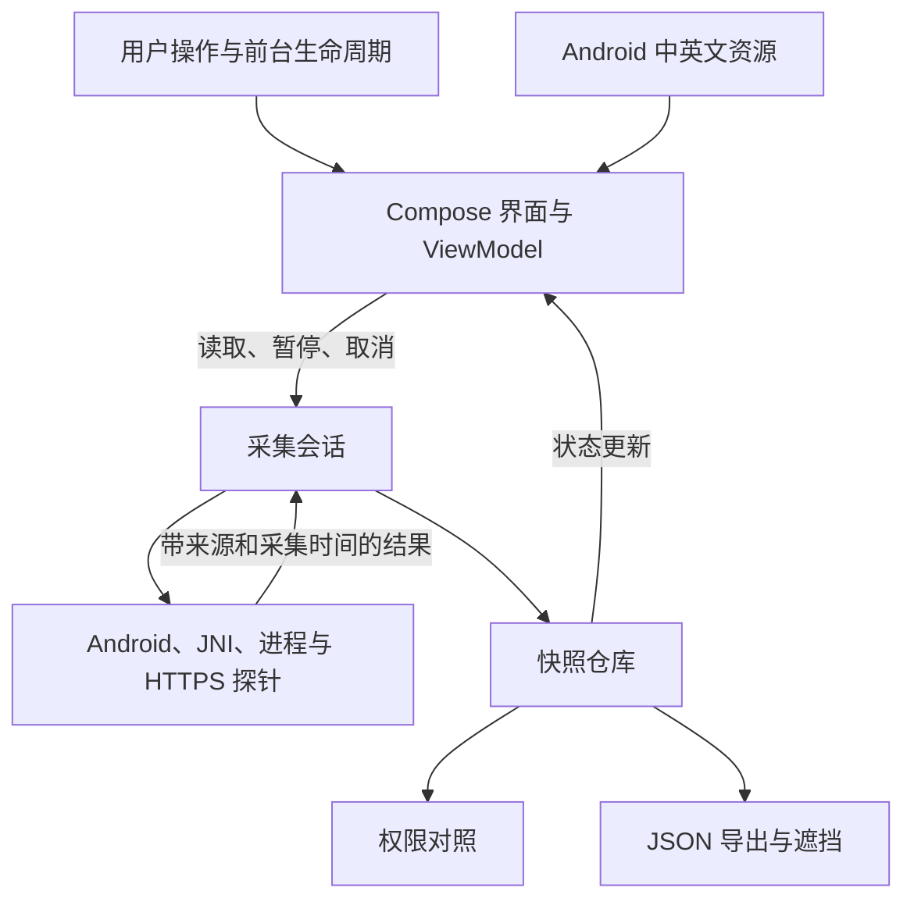

# 架构调整计划

本文记录本轮重构的组件边界与维护约定，涵盖快照、权限、采集会话、中英文界面和导出契约。本目录随源码维护，后续进入 `main`。

## 组件结构

保留一个 Android 应用模块，采用 MVVM 与单向数据流。界面负责展示和用户操作，采集会话管理任务，仓库统一保存并组装快照，平台探针读取系统信息。

复用集中在字段定义、权限条件、任务状态和快照组装。接口、订阅等栏目继续保留各自的摘要组件。平台资源通过构造参数装配，纯数据规则使用 JVM 测试验证。

## 变更阶段

| 阶段 | 主要工作 | 完成依据 |
|---|---|---|
| 1. 快照边界 | 统一基础与手动结果的组装入口，修正权限对照取样 | 对照前后使用相同组装规则，手动栏目保持存在 |
| 2. 字段契约 | 结构化权限和敏感等级，集中稳定字段键 | 权限提示由数据生成，新增字段显式选择敏感等级 |
| 3. 采集会话 | 提取任务调度、取消与状态提交，瘦身 ViewModel | 可控测试覆盖退后台、重入、关闭实验和延迟返回 |
| 4. 国际化 | 提取资源与诊断代码，补齐英文，接入系统语言设置 | 中文、英文和回退语言可用，JSON 语义保持稳定 |
| 5. 契约验证 | 联动导出模型、Schema、人工示例和 CI | 完整与遮挡导出通过验证，语言变化只影响展示 |

每阶段维持可构建状态，执行相关 JVM 测试、构建和 Lint。Android 15 的界面冒烟检查放在采集会话与英文阶段；设备覆盖按改动需要安排。

## 详细设计

- [组件职责与数据契约](architecture.md)：职责边界、缓存、权限、取消和迁移规则。
- [国际化与英文支持](i18n.md)：资源组织、展示与导出的分离、语言切换和验收。

分层与单向数据流参考 [Android 架构建议](https://developer.android.com/topic/architecture/recommendations)。组件数量与复用范围按本项目规模确定。

## 本轮验证

- debug、release、设备测试 APK 构建通过；JVM 测试 56 项通过。
- Android 15 / API 35 / 16 KiB 模拟器的 14 项设备测试通过，覆盖生命周期、权限、栏目、语言回退、大字体、双向布局和地址复制。
- JNI 主机测试 3 项、发布工具测试 8 项、服务端测试 2 项通过。
- Schema 验证覆盖实际生成的完整与遮挡导出及仓库示例；双语资源键、格式参数与诊断映射检查通过。
- 两种 APK 的签名、四种 ABI 与 16 KiB 布局检查通过。Lint 为 0 个错误，debug / release 分别保留 19 / 22 条警告，主要来自依赖更新建议、已有模板资源和 API 范围检查。

CI 已接入资源与导出契约检查。实际导出生成在 `app/build/contract-exports/`，与 `samples/` 的人工数据示例逐项比较。设备检查在本轮执行，CI 继续运行本地检查与设备测试 APK 编译。
