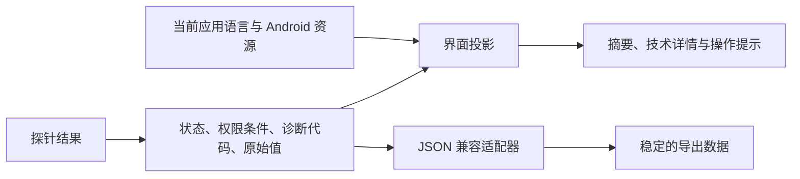

# 国际化与英文支持

## 资源策略

采用 Android 标准资源选择机制。最终 `res/values/strings.xml` 提供完整英文回退资源，`res/values-b+zh+Hans/strings.xml` 提供简体中文。首轮提取时 `values/` 继续放中文；英文完整后，一次性完成默认资源与中文目录的调整。

正文、按钮、页签、状态、授权提示、技术解释、Snackbar、复制成功提示、无障碍描述和数量文字均使用资源。按功能命名资源键，为有歧义的术语补翻译注释。英文目录沿用同一组语义键。

Compose 使用 `stringResource`、`pluralStringResource`，动态句子使用位置参数和 plurals。数量格式、单位和时间显示随界面 Locale 选择；JSON 的 UTC 时间、数字和协议标识维持原始格式。技术值如 IP、CIDR、MCC/MNC、接口名、属性键和 API 名按原样显示与复制。

字符串资源中的纯技术常量可标记 `translatable="false"`。运营商名称、SSID 和服务器返回值视为观测数据，保持系统或服务提供的文本。

## 数据与展示的边界

探针返回稳定状态、诊断代码及类型明确的参数；字段定义中的权限标识用于判断，Android 资源用于显示。UI 在当前界面配置中解析文字，ViewModel 保存代码与参数。缓存、比较与导出均使用原始数据。

当前散落在模型和探针中的中文 `note` 逐步转换为诊断代码。迁移时保留导出兼容映射，界面直接按代码选择资源。资源 ID 留在界面层，数据模型通过稳定代码与界面关联。

一次性操作反馈采用带标识的 UI 消息状态，由界面确认消费；消息保留代码与参数，显示时解析资源。语言切换后的界面重建从最新状态恢复栏目选择，完整值显示状态仍按现有隐私策略复位。

## 语言选择

英文完成后，采用 AGP 自动生成 LocaleConfig，设置默认资源语言 `en`，资源打包语言限定为 `en` 和 `b+zh+Hans`，核对产物中的支持语言列表。

Android 13+ 使用系统“应用语言”入口，Android 8–12 跟随系统资源选择。首轮语言切换采用系统设置入口，现有 ComponentActivity 继续使用。若后续增加应用内语言选择，再评估 AndroidX 的兼容接入。

设备语言、应用语言和网络探测使用各自的系统机制。语言切换后的基础采样沿用前台生命周期规则；手动公网、getprop、JNI 和历史订阅读取仍由原操作触发。

## 展示与可访问性

采用 start/end 布局属性，保留当前 RTL 支持。IP 和 CIDR 等技术值在混合方向文本中以独立 LTR 段显示，复制内容保持原始文本。容器按内容伸展，为英文长标签和字体缩放留空间。

UI 测试使用稳定 testTag 与语义定位，文字断言从当前资源获取。需要核对翻译时单独断言指定资源，避免将中文按钮字面量用作通用操作定位。

## 验收

| 场景 | 预期 |
|---|---|
| 默认资源检查 | 所有资源引用在 `values/` 中有定义，英文阶段中英文资源键与参数对应 |
| 中文、英文与其他系统语言 | 中文显示简体中文，英文显示英文，其他语言使用英文回退 |
| Android 15 应用语言切换 | 标题、提示、技术详情和后续消息采用当前语言 |
| 带缓存切换语言 | 原始观测值保留；比较结果与 JSON 协议字段保持稳定 |
| 数量、位置参数和特殊字符 | plurals、占位参数、百分号及转义经资源编译和测试验证 |
| `en-XA`、`ar-XB` 与大字体 | 检查长文本、方向、地址复制和按钮操作 |
| 覆盖检查 | Lint 与资源检查识别遗漏翻译、占位参数差异和新增硬编码界面文字 |

测试以固定时间和人工观测数据比较两种界面的投影与导出；设备验证重点放在 Android 15，旧版本语言回退按兼容范围检查。

## 参考

- [Android 本地化](https://developer.android.com/guide/topics/resources/localization)：默认资源与语言目录。
- [Compose 资源](https://developer.android.com/develop/ui/compose/resources)：字符串、位置参数和复数资源。
- [应用语言设置](https://developer.android.com/guide/topics/resources/app-languages)：LocaleConfig 与系统语言入口。
- [字符串资源](https://developer.android.com/guide/topics/resources/string-resource)：资源格式与数量表达。

资源机制依据官方文档；默认英文、中文目录和阶段顺序是本项目的设计选择。
